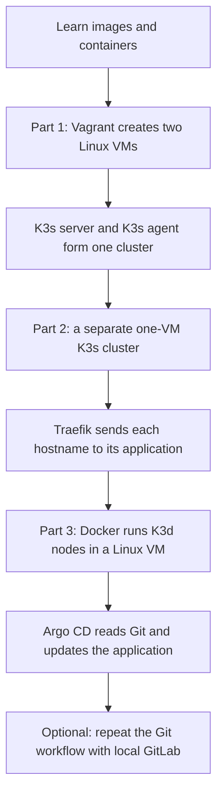

# Inception of Things: start here

This repository is a beginner's companion to the **Inception-of-Things, version 4.0** subject. You can start without knowing Kubernetes. Read a little, build a little, check that it works, then continue.

**This is documentation, not a completed submission.** The guides contain examples to understand and turn into your own files. They do not create machines just by being present in this repository. No cluster or deployment has been run to validate these examples here.

## Read in this order

| Step | Read | What you will be able to do afterward |
| --- | --- | --- |
| 1 | [What the subject actually requires](docs/01-subject-map.md) | Tell requirements apart from suggestions |
| 2 | [The small building blocks](docs/02-building-blocks.md) | Explain an image, container, Pod, Service, and Ingress |
| 3 | [Prepare your workspace](docs/03-workspace.md) | Choose the right machine and terminal; install prerequisites |
| 4 | [Part 1: two machines](p1/README.md) | Connect one K3s server and one agent |
| 5 | [Part 2: three applications](p2/README.md) | Route requests by hostname and run three app2 replicas |
| 6 | [Part 3: Git controls deployment](p3/README.md) | Watch Argo CD deploy an image change from Git |
| 7 | [Practice the evaluation](docs/05-evaluation.md) | Demonstrate each requirement and explain what you built |
| Optional | [Bonus: local GitLab](bonus/README.md) | Plan a local GitLab integration after mandatory work is solid |

Keep [the troubleshooting guide](docs/04-troubleshooting.md) open while working. [Official references](docs/06-references.md) are there when you want the full explanation. [Your lab notebook](docs/07-lab-notebook.md) records the choices and versions you actually use.

## The whole project in one picture

These are **three separate labs**. Part 2 does not need Part 1's worker. Part 3 does not reuse either Vagrant cluster.

If your Markdown viewer cannot draw Mermaid, read this as: containers → two-node K3s → one-node K3s with web routing → K3d with Git-driven deployment → optional local GitLab.

## How to use command examples

- Commands marked **LAB** run in the Linux VM where you keep the repository.
- Commands marked **SERVER** or **AGENT** run after entering that Vagrant machine with SSH.
- Commands marked **WINDOWS** run in PowerShell on your physical computer.
- Copy the text inside a command block, without adding a `$` prompt.
- A block marked `yaml`, `ruby`, or `dockerfile` is **file content**, not a terminal command. Its paragraph tells you which file to create.
- Replace placeholders such as `YOUR_LOGIN`, `YOUR_GITHUB_OWNER`, and `YOUR_BOX` before using the example. Your 42 login and GitHub username may differ.
- Run commands in order. A foreground command such as `port-forward` needs its own terminal; leave it open.

The subject is the authority on submission requirements. Technical documentation changes; links were checked on **13 November 2026**, and you should record and retest your selected versions.

Start with [the requirement map](docs/01-subject-map.md).
