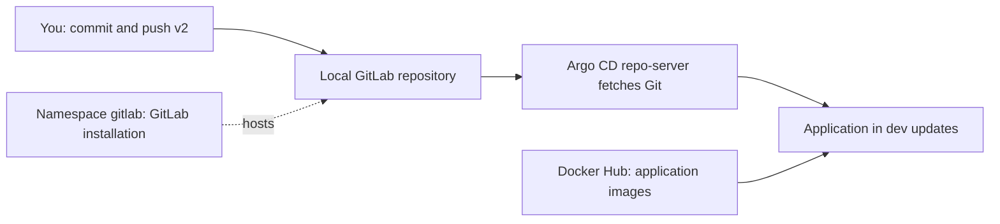

# Optional bonus: use your own local GitLab

[Start page](../README.md) · [Mandatory Part 3](../p3/README.md) · [Evaluation practice](../docs/05-evaluation.md)

Only start after you can rebuild and demonstrate every mandatory requirement. The subject says incomplete mandatory work prevents bonus assessment.

The new idea is small: replace the GitHub source used by your application with a Git repository hosted on your own local GitLab. Installing GitLab itself is the demanding part.



Read as: push to local GitLab → Argo fetches local GitLab → app updates. The image can still come from Docker Hub. A GitLab Runner or image registry is not automatically needed just to repeat Part 3's GitOps demonstration.

## 1. Plan before installing

The subject requires the latest GitLab release available from its official source when you do the bonus. Do not use an old blog post's pinned release and call it current. Chart version and GitLab application version are different numbers.

Guide choice: install the official GitLab Helm chart in the K3d cluster, in namespace `gitlab`. **Helm** installs a collection of Kubernetes objects called a **chart**; a **values file** provides settings; a **release** is one installed instance of that chart.

Read the current [chart prerequisites](https://docs.gitlab.com/charts/installation/) and [deployment procedure](https://docs.gitlab.com/charts/installation/deployment/) first. At the documentation check date, the official chart requires external PostgreSQL, Redis, and object storage. Old examples assuming every dependency is bundled may no longer work. "External" here means outside the chart's managed dependencies, not necessarily outside your local lab. These services can be provisioned separately in the lab, with persistent storage and compatible versions.

This is a planning and integration guide, not a universal ready-to-run GitLab values file. Your current chart, storage, DNS, and TLS choices determine that file. Do not skip those prerequisites and expect a bare `helm install` to provide a working installation.

Record:

| Decision | What you must supply |
| --- | --- |
| GitLab release | Latest official application release when implemented |
| Helm chart version | The chart that packages that application release |
| Available resources | Enough for GitLab plus the already running mandatory lab; use [current requirements](https://docs.gitlab.com/install/requirements/) |
| Persistent storage | Storage class, capacity, and what survives cluster deletion |
| PostgreSQL / Redis / object storage | Compatible local services and connection settings according to the selected chart |
| GitLab hostname and URL | Reachable by both your browser/Git client and Argo's repo-server |
| Ingress controller | Explicit controller/class; avoid conflicting controllers on the same ports |
| TLS | A certificate chain trusted by your Git client and Argo CD |
| Git authentication | Public read access, or a read-only deploy credential in a Secret |

Keep generated credentials out of your values file in Git; reference Kubernetes Secrets instead. Keep non-secret configuration under `bonus/confs/`, installation and bootstrap steps under `bonus/scripts/`.

## 2. Discover and pin the chart

Install Helm using its [official installation guide](https://helm.sh/docs/intro/install/). Then **LAB**:

```bash
helm repo add gitlab https://charts.gitlab.io/
helm repo update
helm search repo gitlab/gitlab --versions
```

The table shows chart `VERSION` and GitLab `APP VERSION`. Match the selected chart to the latest official GitLab release. Then replace the placeholder:

```bash
export IOT_GITLAB_CHART_VERSION='YOUR_VERIFIED_CHART_VERSION'
mkdir -p bonus/confs bonus/scripts
helm show chart gitlab/gitlab --version "$IOT_GITLAB_CHART_VERSION"
helm show values gitlab/gitlab --version "$IOT_GITLAB_CHART_VERSION" \
  > bonus/confs/upstream-values.yaml
```

Use the selected release's [values documentation](https://docs.gitlab.com/charts/installation/command-line-options/) to write a **small** `bonus/confs/values.yaml` containing only deliberate overrides. Supply hostnames, controller/TLS settings, external-service endpoints, Secret references, and storage settings. Do not paste default values from a different chart version.

Create the namespace, provision the prerequisites, and review a render **before** installation:

```bash
kubectl create namespace gitlab --dry-run=client -o yaml | kubectl apply -f -
helm template gitlab gitlab/gitlab --namespace gitlab \
  --version "$IOT_GITLAB_CHART_VERSION" --values bonus/confs/values.yaml
```

The rendered output can contain credentials if you put them into values; keep it local. When reviewed and prerequisites are ready:

```bash
helm upgrade --install gitlab gitlab/gitlab --namespace gitlab \
  --version "$IOT_GITLAB_CHART_VERSION" \
  --values bonus/confs/values.yaml --timeout 20m --wait
helm status gitlab --namespace gitlab
kubectl -n gitlab get pods,pvc,services,ingresses,jobs
```

A Helm success message does not establish that Git cloning, migrations, and application deployment work. Inspect failed Jobs and Pending PVCs before trying longer timeouts. Save the exact procedure in `bonus/scripts/` and test rebuilding it.

## 3. Solve the network from both directions

Your Linux hosts file changes only that Linux machine. It does not automatically change CoreDNS inside the cluster. A browser opening GitLab proves only the browser's path.

```text
Path A: your Git client → advertised GitLab hostname → Git HTTP/SSH endpoint
Path B: argocd-repo-server Pod → GitLab Git endpoint
```

`localhost` in Argo's repo-server Pod refers to that Pod. It does not mean the lab VM, Windows, or the GitLab Pod. Use a hostname resolved inside the cluster, a Kubernetes Service DNS name with the correct port where supported, or deliberately configured DNS/host routing to your ingress. Account for redirects: an internal URL that redirects to an unresolvable external hostname still fails.

If GitLab's controller needs host ports that were not mapped when creating K3d, plan those mappings in the cluster bootstrap. Do not destroy a cluster with valuable GitLab data just to add a port without first handling storage and backups.

Test the Git smart-HTTP endpoint from the same network as Argo CD, using a temporary diagnostic Pod if the repo-server image lacks curl/git. Check DNS, HTTP response, redirects, certificate trust, and authorization separately. You can also inspect:

```bash
kubectl -n argocd logs deployment/argocd-repo-server --tail=100
kubectl -n gitlab get services,ingresses
kubectl get storageclass
```

Logs may contain repository URLs or authentication context; sanitize them before recording evidence. Configure trust for a local CA using [Argo CD's repository connection guidance](https://argo-cd.readthedocs.io/en/stable/user-guide/private-repositories/) rather than disabling TLS verification globally.

## 4. Move the source repository and repeat the test

Create a project in local GitLab. Push the same `manifests/deployment.yaml` and `manifests/service.yaml` from Part 3, starting at v1. Retain the GitHub remote so you can still demonstrate the mandatory workflow:

```bash
git remote add local-gitlab YOUR_LOCAL_GITLAB_CLONE_URL
git push -u local-gitlab main
```

If the project is private, register a read-only deploy credential in Argo CD via its repository settings or an appropriate Secret. Your personal credentials used for `git push` are not automatically available to Argo's repo-server.

Store a bonus-specific Application definition under `bonus/confs/`. It should target the **same app resources** in `dev`, use the local GitLab repository URL, and keep automatic synchronization enabled. For the demonstration, change the existing `playground` Application's source deliberately, or disable/remove its old management before introducing a replacement. Do not have two active Argo Applications compete over the same Deployment and Service.

Now edit the deployment image from v1 to v2, commit, and **push to `local-gitlab`**, not just `origin`. Prove the synced commit, v2 Deployment, ready Pod, and v2 HTTP response, exactly as in [Part 3](../p3/README.md#8-the-demonstration-that-matters-v1--v2-through-git).

## Bonus completion check

- [ ] Mandatory GitHub deployment remains reproducible.
- [ ] Namespace `gitlab` exists and local GitLab works.
- [ ] Selected GitLab release was the latest official one when implemented; application and chart versions are recorded.
- [ ] Persistence and credentials are handled deliberately.
- [ ] Your Git client can push; Argo's repo-server can fetch.
- [ ] A version change pushed to local GitLab automatically changes the observed app.
- [ ] Bonus configuration and scripts are committed under `bonus/`.
