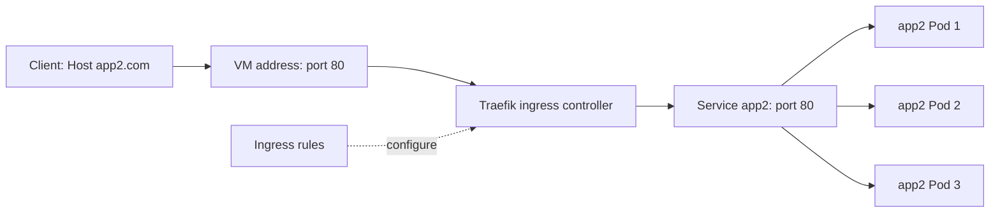

# The small building blocks

[Start page](../README.md) · [Previous: requirements](01-subject-map.md) · [Next: workspace](03-workspace.md)

## A machine, an image, and a container

Your physical computer is a house. A virtual machine is a smaller pretend computer inside that house: it has its own operating system and kernel. A container is more like a room: applications are separated, but Linux containers use the kernel of the machine running them.

An **image** is the packaged starting material for an application. A **container** is a running instance made from that image. One image can start many containers, just as one recipe can make many cakes.

```text
Docker Hub or another registry       Your Linux machine
┌───────────────────────┐   pull    ┌─────────────────────────────┐
│ image: nginx:alpine   │ ────────> │ stored image                │
└───────────────────────┘           │   ├─ container A, running   │
                                    │   └─ container B, running   │
                                    └─────────────────────────────┘
```

A **registry** stores images. A **tag**, such as `v1`, is a label for an image version. A tag can be moved by its publisher. A digest such as `sha256:...` identifies specific image content. Use the subject's `v1`/`v2` tags for the demonstration; record image digests when you need exact reproduction.

Docker and Podman can build and run containers. Their similar commands do not make every tool interchangeable. Parts 1 and 2 use K3s's bundled **containerd** runtime; Docker is not required in those guest VMs. Part 3 explicitly uses Docker to run K3d nodes. K3d's Podman support is experimental, so this guide uses Docker there. See the [K3d Podman documentation](https://k3d.io/stable/usage/advanced/podman/).

## A five-minute Docker exercise

**LAB, after Docker is installed** following [workspace setup](03-workspace.md):

```bash
docker run --detach --name first-web --publish 127.0.0.1:8081:80 nginx:alpine
curl http://127.0.0.1:8081
docker ps
docker logs first-web
docker stop first-web
docker rm first-web
```

`run` creates and starts a container. `--detach` leaves it in the background. `--name` gives you an easy handle. The port mapping means **Linux lab VM port 8081 → container port 80**, bound only to the lab VM's loopback interface. Expect Nginx's HTML page from `curl`.

`stop` stops the process; `rm` removes the stopped container. Neither removes the downloaded image. `docker ps -a` also shows stopped containers. These commands assume your lab user has Docker access; otherwise use `sudo docker` consistently until you configure it.

Changing files inside a container is temporary unless you arrange persistent storage. For this subject the example applications can be stateless; Git, not a hand-edited container, should describe the desired application.

## Why Kubernetes exists

With one container you can remember to restart it. With many applications on several machines, you want a system to maintain your instructions: "keep three copies of this app running."

Kubernetes watches the desired state and tries to make reality match it. This repeated checking is called **reconciliation**. If a Pod disappears, Kubernetes can create a replacement. It does not magically fix a broken application image or give you more physical RAM.

| Word | Plain meaning | In this project |
| --- | --- | --- |
| Cluster | Machines managed together | Part 1's server and agent |
| Node | A machine registered in a cluster | A Vagrant VM, or a K3d node container |
| Control plane | Components that track and manage cluster state | Runs on the K3s server |
| Agent/worker | A node that runs assigned workloads | Part 1's second machine |
| Pod | Kubernetes' smallest scheduled unit; usually one app container here | One copy of app2 |
| Deployment | Instructions for maintaining and updating Pods | Request three app2 replicas |
| Replica | One of several copies | Three app2 Pods in Part 2 |
| Service | A stable in-cluster address for a selected set of Pods | Sends app2 traffic to app2 Pods |
| Ingress | HTTP routing rules | `app1.com` goes to app1 |
| Ingress controller | Software that actually handles those rules | Traefik in this guide |
| Namespace | A named grouping inside a cluster | `argocd`, `dev`, later `gitlab` |
| Manifest | A YAML file describing an object | A Deployment or Service file |
| kubectl | The command-line client talking to Kubernetes | `kubectl get pods` |
| kubeconfig | Client configuration with cluster address and credentials | Lets kubectl reach the correct cluster |
| Context | A named cluster/user/namespace selection in kubeconfig | `k3d-iot` in Part 3 |
| ConfigMap | Non-secret configuration provided to an app | Web page text in Part 2 |
| Secret | An object intended for credentials | Argo CD's initial admin password |

A namespace is not another VM or another cluster. It is also not a complete security boundary by itself. A Secret's base64 encoding is not encryption.

## The request's journey in Part 2



Read it as: client → VM → controller → Service → a ready Pod. The Deployment maintains the three Pods in the background; it is not a network hop.

**Labels** are little name stickers on objects. A Service's **selector** says which stickers to look for. A Service selecting `app: app2` needs Pods labeled `app: app2`; a spelling difference leaves it with no backends.

## K8s, K3s, K3d, and Vagrant

- **K8s** is an abbreviation for Kubernetes: eight letters between K and s.
- **K3s** is a lightweight Kubernetes distribution, with useful bundled components.
- **K3d** creates K3s clusters whose nodes run in Docker containers. It is not another unrelated orchestration system.
- **Vagrant** creates and configures VMs from a `Vagrantfile`. A **provider**, such as VirtualBox, supplies the virtualization. A **box** is a VM template, not a Docker image.

```text
Parts 1 / 2                         Part 3
Linux lab VM                        Linux lab VM
└─ VirtualBox                       └─ Docker
   └─ Vagrant guest VM(s)               └─ K3d node container(s)
      └─ K3s                              └─ K3s
         └─ application Pods                 └─ application Pods
```

## Reading a YAML file without panic

```yaml
apiVersion: v1
kind: Namespace
metadata:
  name: dev
```

This says: use the `v1` API, create a Namespace, name it `dev`. Save it as a `.yaml` file, then use `kubectl apply -f path/to/file.yaml` in the right cluster. Spaces are significant; use spaces rather than tabs. `---` separates several objects in one file. YAML keys are case-sensitive.

`kubectl apply` creates or updates an object. `kubectl get` lists it. `kubectl describe` explains details and events. `kubectl logs` shows application output. `kubectl delete` removes an object and can interrupt work.

## GitOps: a second loop around Kubernetes

In Part 3, Argo CD compares Git's YAML with the cluster. If Git says `v2`, Argo CD updates the Deployment. Kubernetes then replaces the running Pods to match that Deployment.

```text
You edit YAML → commit → push → Argo CD reads Git
                                  ↓
                            Deployment changes
                                  ↓
                          Kubernetes updates Pods
                                  ↓
                            HTTP response is v2
```

The Git commit and the image tag are different things. Git stores the instruction `image: wil42/playground:v2`; Docker Hub stores the executable image. Argo CD does not build the image, and Git does not contain its layers.

Before continuing, try explaining aloud: "an image starts a container; Kubernetes runs it in a Pod; a Deployment keeps the requested copies alive; a Service reaches the Pods; an Ingress controller routes HTTP to the Service."
