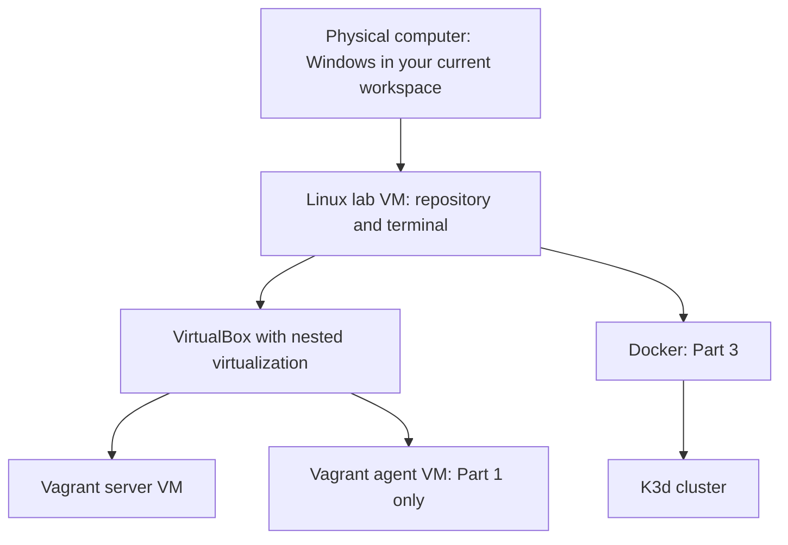

# Prepare a workspace you can explain

[Start page](../README.md) · [Previous: concepts](02-building-blocks.md) · [Next: Part 1](../p1/README.md)

## Decide where commands run

The subject says the whole project must be done in a VM. The conservative setup used by these guides is a Linux **lab VM**, with Vagrant's own guests nested inside it for Parts 1 and 2. For Part 3, Docker and K3d run directly in the lab VM. Do not add Vagrant to Part 3 just because you used it earlier.



Nested virtualization means the outer hypervisor must expose CPU virtualization features to the lab VM. Provider support, CPU architecture, and host hypervisor settings matter. Before installing Kubernetes, prove that a small Vagrant guest can boot inside the lab VM. If it cannot, fix that foundation first. A different supported Vagrant provider is allowed. A native Windows Vagrant setup produces Linux VMs but differs from this conservative outer-VM layout; confirm any alternative interpretation with your evaluator before relying on it.

**Do not install everything on Windows just because the repository currently lives there.** Windows can be your editor and SSH client. Keep the working checkout inside the Linux VM's filesystem, for example `~/42IoT`, rather than running Linux scripts from a Windows shared folder.

## Choose a Linux release and resources

Guide choice: use a current stable Debian release on an x86-64 lab machine. As checked on 13 November 2026, [Debian lists version 13, trixie, as stable](https://www.debian.org/releases/). Recheck when you start. The subject requires the latest stable release of your chosen distribution for the Vagrant guests; an old example box is not a substitute.

Do not assume an x86-64 VM image works on ARM. Select matching VM boxes, Docker images, and downloaded binaries for your architecture.

| Environment | Initial planning budget, not a subject requirement |
| --- | --- |
| Outer Linux lab VM | Around 4 vCPUs, 8 GB RAM, 40 GB free disk for mandatory work; adjust to your physical machine |
| Part 1 server guest | Current upstream K3s baseline is 2 CPU cores and 2 GB RAM |
| Part 1 agent guest | Current upstream K3s baseline is 1 CPU core and 512 MB RAM |
| Part 2 server guest | Start from the server baseline, then watch the three apps |
| Part 3 | Leave enough lab VM memory for Docker, K3s, Argo CD, and the application |
| Bonus | Budget separately from current GitLab requirements; it can need substantially more memory and disk |

The subject recommends much smaller Part 1 VMs. You may experiment with that guidance, but monitor actual usage and avoid claiming that current software is guaranteed to fit. Record deviations and the reason. [K3s's current requirements](https://docs.k3s.io/installation/requirements) distinguish server and agent needs.

## First commands inside the lab VM

**LAB**, Debian family:

```bash
sudo apt-get update
sudo apt-get install -y ca-certificates curl git openssh-client openssl
uname -m
cat /etc/os-release
free -h
df -h
ip -br address
```

`sudo` runs one command as administrator. `apt-get update` refreshes the package list; it does not upgrade installed packages. Confirm the OS, architecture, free memory, and disk before continuing.

Install Vagrant using [HashiCorp's installation instructions](https://developer.hashicorp.com/vagrant/install), and a matching VirtualBox release using [Oracle's documentation](https://www.virtualbox.org/manual/ch02.html). Use the supported pairing for your Linux version and CPU. Kernel headers/modules and nested virtualization must work. Then:

```bash
vagrant --version
VBoxManage --version
git clone git@github.com:ErwanLucienMMV/42IoT.git
cd 42IoT
git status
```

The SSH clone needs a key authorized in your GitHub account. For read-only access to a public repository you can use its HTTPS URL instead. Pushing still needs authentication. Do not copy private keys into this repository.

## Select a real Vagrant box

Open the [Vagrant box catalog](https://portal.cloud.hashicorp.com/vagrant/discover), choose a maintained box for the **current stable OS**, and verify that it supports your provider and architecture. This guide deliberately does not invent a box name or version.

In the LAB terminal, set the values you verified. Replace the entire placeholder strings:

```bash
export IOT_LOGIN='YOUR_LOGIN'
export IOT_BOX='YOUR_BOX'
export IOT_BOX_VERSION='YOUR_VERIFIED_BOX_VERSION'
export IOT_K3S_VERSION='YOUR_VERIFIED_K3S_RELEASE'
```

A K3s release string has the form `vX.Y.Z+k3sN`; obtain a real stable release from the [K3s releases](https://github.com/k3s-io/k3s/releases). Pin the same release on both Part 1 nodes. Check that the OS inside the box is still the latest stable distribution release. Exported variables last only in that shell and child processes. Put the selected, non-secret values in your [lab notebook](07-lab-notebook.md), then re-export them in later shells.

## Docker for Part 3

Install Docker **Engine inside the Linux lab VM** using the [official Debian installation guide](https://docs.docker.com/engine/install/debian/). The installation procedure includes the signing key, package repository, and packages. Follow the current page for your release instead of combining instructions from different distributions. For the Part 3 deliverable, turn those steps into `p3/scripts/install-dependencies.sh` and test it on a clean VM.

Verify the daemon and a first container:

```bash
sudo systemctl enable --now docker
sudo docker run --rm hello-world
```

For commands without `sudo`, you may grant your own lab user Docker access:

```bash
sudo usermod -aG docker "$USER"
```

Log out of the Linux session and log back in, then run `docker info`. Membership in this group gives administrator-level control of that VM. Keep it limited to your lab user. If you choose to keep using `sudo`, use it consistently with K3d too; mixing root and non-root users can leave kubeconfig in the wrong home directory.

Docker Desktop on Windows is a separate daemon. A successful `docker ps` in Windows does not show that Docker works in the Linux lab VM. Podman is useful to know, but this subject's Part 3 path uses Docker.

## Network addresses are relative to a machine

`127.0.0.1` and `localhost` mean **this machine**, not every machine in the diagram. A browser on Windows cannot reach the lab VM's loopback just by opening Windows's localhost.

Use the lab VM's own browser or `curl` first. For a loopback-only lab service, forward it through SSH. **WINDOWS**, using the outer VM's reachable SSH address:

```powershell
ssh -N -L 8080:127.0.0.1:8080 -L 8888:127.0.0.1:8888 LAB_USER@LAB_VM_SSH_ADDRESS
```

Keep that terminal open. Windows `https://127.0.0.1:8080` now reaches a lab VM service listening on 8080; Windows `http://127.0.0.1:8888` reaches its port 8888. If the outer hypervisor forwards SSH to a host port, use that host address and add `-p PORT`.

The Vagrant private network `192.168.56.0/24` belongs **inside the Linux lab VM** in this layout. Your Windows browser may not have a route to it. Use `curl` in the lab VM for Parts 1 and 2. Check for subnet collisions with outer VM, VPN, Docker, and existing host-only networks.

Common project ports:

| Port | Purpose | Relevant path |
| --- | --- | --- |
| TCP 22 | SSH, unless forwarded to another host port | Lab → Vagrant guests |
| TCP 6443 | K3s Kubernetes API | Agent → server |
| UDP 8472 | Default Flannel VXLAN between nodes | Private guest-to-guest network |
| TCP 10250 | Kubelet API/metrics | Cluster nodes as needed |
| TCP 80 | Part 2 HTTP entry point | Lab → server guest |
| TCP 8080 | Guide's local Argo CD UI forwarding | Lab loopback |
| TCP 8888 | Example app HTTP listener and guide's local access port | See Part 3's explicit mapping |

Check the complete [K3s network requirements](https://docs.k3s.io/installation/requirements) for your configuration. Keep cluster internals on the lab network; do not expose VXLAN to the internet.

## Files and scripts that survive a rebuild

- Keep scripts in each part's `scripts/`, configs in `confs/`, and `Vagrantfile` at that part's root.
- Use LF line endings. `.gitattributes` requests these even when editing from Windows.
- Begin Bash scripts with `#!/usr/bin/env bash` and `set -euo pipefail`. This stops on many errors instead of silently continuing.
- Read downloaded installation scripts before running them. Record the selected release.
- Avoid committing `.vagrant`, kubeconfig, tokens, passwords, private keys, and downloaded tools. `.gitignore` helps, but review what you stage.
- Make scripts executable with `chmod +x p1/scripts/install-k3s.sh`, then commit that executable bit. Vagrant can invoke a shell provisioner without it, but your own direct execution needs it.
- Prefer bounded readiness checks to fixed long sleeps. A service taking time is normal; a script hanging forever is not.

You are ready for [Part 1](../p1/README.md) when Vagrant can start a guest, you can SSH into it, and the lab VM can reach its dedicated address.
