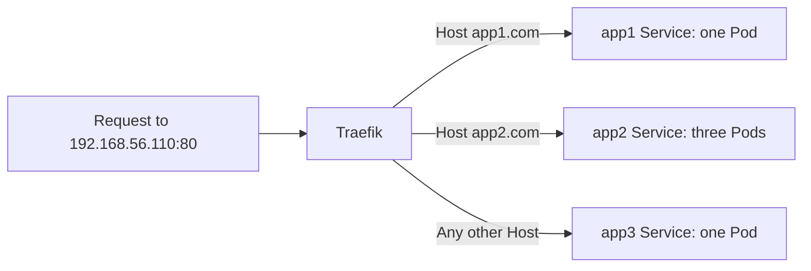

# Part 2: three applications behind one address

[Start page](../README.md) · [Previous: Part 1](../p1/README.md) · [Next: Part 3](../p3/README.md)

Goal: one K3s server VM, three apps, one HTTP entry point. The requested hostname decides which app answers. App2 has three running copies. Apps 1 and 3 have one each in this guide.



The same address serves every app. Typing `/app1` into the URL is not the hostname-routing requirement.

## 1. Start a separate one-machine lab

Remove Part 1's guests with `vagrant destroy` **from `p1/`** once you are ready to discard their disks. This avoids reusing `.110` on the same network.

**LAB**, repository root, after exporting your choices from [workspace setup](../docs/03-workspace.md):

```bash
mkdir -p p2/scripts p2/confs
cp p1/Vagrantfile p2/Vagrantfile
cp p1/scripts/install-k3s.sh p2/scripts/install-k3s.sh
cd p2
```

Edit the new **`p2/Vagrantfile`**:

1. Remove the array row for `"#{login}SW"` entirely. Leave only the server row, address `.110`.
2. Change `provider.name = "iot-p1-#{name}"` to `provider.name = "iot-p2-#{name}"`.
3. Inside `config.vm.define`, immediately after the existing K3s shell provisioner, add the following provisioners:

```ruby
machine.vm.provision "file", source: "confs/apps.yaml",
  destination: "/tmp/iot-apps.yaml"
machine.vm.provision "file", source: "confs/ingress.yaml",
  destination: "/tmp/iot-ingress.yaml"
machine.vm.provision "shell", path: "scripts/deploy-apps.sh"
```

Do not run `vagrant up` yet: create these referenced files first. The rest of Part 1's token creation, static addressing, and installation logic can stay. In Part 2 there is no worker to join, but a local server token remains valid.

## 2. Create three tiny web applications

Guide choice: Nginx serves a different static page for each app. This avoids needing to write and publish application images for Part 2. The subject allows web applications of your choice.

The following **LAB Bash commands**, run in `p2/`, generate **`p2/confs/apps.yaml`**. The loop saves typing; the resulting file contains ordinary ConfigMaps, Deployments, and Services. Rerunning the block replaces that generated file.

```bash
: > confs/apps.yaml
for number in 1 2 3; do
  replicas=1
  if [ "$number" -eq 2 ]; then replicas=3; fi
  cat >> confs/apps.yaml <<EOF
apiVersion: v1
kind: ConfigMap
metadata:
  name: app${number}-page
data:
  index.html: |
    <!doctype html>
    <html><body><h1>Hello from app${number}</h1></body></html>
---
apiVersion: apps/v1
kind: Deployment
metadata:
  name: app${number}
spec:
  replicas: ${replicas}
  selector:
    matchLabels:
      app: app${number}
  template:
    metadata:
      labels:
        app: app${number}
    spec:
      containers:
        - name: web
          image: nginx:alpine
          ports:
            - name: http
              containerPort: 80
          readinessProbe:
            httpGet:
              path: /
              port: http
            initialDelaySeconds: 2
            periodSeconds: 3
          volumeMounts:
            - name: page
              mountPath: /usr/share/nginx/html
              readOnly: true
      volumes:
        - name: page
          configMap:
            name: app${number}-page
---
apiVersion: v1
kind: Service
metadata:
  name: app${number}
spec:
  selector:
    app: app${number}
  ports:
    - name: http
      port: 80
      targetPort: http
---
EOF
done
```

Read the result in your editor before continuing. For app2, find `replicas: 3`. Notice that its Deployment's selector, Pod label, and Service selector all agree on `app: app2`.

`containerPort: 80` describes the container's listener. It does not publish that port on the VM. The Service's `port: 80` is its own in-cluster listener, and `targetPort: http` refers to the container's named `http` port.

A ConfigMap provides the HTML file. The readiness probe stops the Service from sending traffic to a Pod before its web server answers. `nginx:alpine` is a convenient floating tag for this exercise; record the resolved image digest or pin a verified version/digest in your own reproducible configuration.

## 3. Add hostname rules and a real fallback

Create **`p2/confs/ingress.yaml`**. These are two Ingress objects using Traefik's route priority annotation: named hosts have priority 100; the hostless fallback has priority 1.

```yaml
apiVersion: networking.k8s.io/v1
kind: Ingress
metadata:
  name: named-apps
  annotations:
    traefik.ingress.kubernetes.io/router.priority: "100"
spec:
  ingressClassName: traefik
  rules:
    - host: app1.com
      http:
        paths:
          - path: /
            pathType: Prefix
            backend:
              service:
                name: app1
                port:
                  number: 80
    - host: app2.com
      http:
        paths:
          - path: /
            pathType: Prefix
            backend:
              service:
                name: app2
                port:
                  number: 80
---
apiVersion: networking.k8s.io/v1
kind: Ingress
metadata:
  name: fallback-app
  annotations:
    traefik.ingress.kubernetes.io/router.priority: "1"
spec:
  ingressClassName: traefik
  rules:
    - http:
        paths:
          - path: /
            pathType: Prefix
            backend:
              service:
                name: app3
                port:
                  number: 80
```

The last rule deliberately has **no `host` field**. A rule only for `app3.com` would not catch requests to the IP or an unknown hostname. The explicit priorities ensure the broad fallback does not steal requests for app1 and app2. These annotations are Traefik-specific; changing controllers means reviewing that behavior.

[Kubernetes explains host and path matching](https://kubernetes.io/docs/concepts/services-networking/ingress/). [Traefik documents the priority annotation](https://doc.traefik.io/traefik/reference/routing-configuration/kubernetes/ingress/). K3s supplies [Traefik and ServiceLB by default](https://docs.k3s.io/networking/networking-services); do not disable them with install flags in this example.

## 4. Automate deployment after K3s installation

Create **`p2/scripts/deploy-apps.sh`**:

```bash
#!/usr/bin/env bash
set -euo pipefail

k3s kubectl wait --for=condition=Ready nodes --all --timeout=180s
for attempt in $(seq 1 120); do
  if k3s kubectl -n kube-system get deployment traefik >/dev/null 2>&1; then
    break
  fi
  sleep 2
done
k3s kubectl -n kube-system rollout status deployment/traefik --timeout=180s
k3s kubectl apply -f /tmp/iot-apps.yaml
for number in 1 2 3; do
  k3s kubectl rollout status "deployment/app${number}" --timeout=180s
done
k3s kubectl apply -f /tmp/iot-ingress.yaml
```

The installer's API readiness is not the same as Traefik readiness. This script waits for the controller and the apps before treating provisioning as successful. The final HTTP checks remain necessary to prove actual routing.

**LAB**, `p2/`:

```bash
chmod +x scripts/*.sh
vagrant validate
vagrant up "${IOT_LOGIN}S"
vagrant ssh "${IOT_LOGIN}S"
```

**SERVER**:

```bash
sudo kubectl get nodes -o wide
sudo kubectl get deployments,pods,services,ingresses
sudo kubectl get ingressclass
sudo kubectl describe ingress named-apps
sudo kubectl describe ingress fallback-app
sudo kubectl -n kube-system get pods,services
exit
```

Expect one Ready node, Deployments with ready counts `1/1`, `3/3`, `1/1`, and a Traefik ingress class. `kubectl get all` does not actually show every object type; request Ingress explicitly.

## 5. Test the four required paths

**LAB**, not Windows and not a container:

```bash
curl --fail --show-error --silent -H 'Host: app1.com' http://192.168.56.110
curl --fail --show-error --silent -H 'Host: app2.com' http://192.168.56.110
curl --fail --show-error --silent http://192.168.56.110
curl --fail --show-error --silent -H 'Host: unknown.example' http://192.168.56.110
```

Expected pages in order: **app1, app2, app3, app3**. `-H` sets an HTTP header. This lets you test routing without DNS or editing the hosts file.

You can also test name resolution and the HTTP Host together:

```bash
curl --resolve app1.com:80:192.168.56.110 http://app1.com
```

For a browser **inside the lab VM**, optionally add these lab-only entries to its `/etc/hosts`:

```text
192.168.56.110 app1.com app2.com
```

Then use `http://app1.com`, with HTTP explicitly. Do not edit the Windows hosts file unless Windows can route to that private guest network. You do not need to own these domains; the hosts entries apply only on the machine where you add them.

## 6. Prove app2 really has three ready copies

Enter the server again, then **SERVER**:

```bash
sudo kubectl get deployment app2
sudo kubectl get pods -l app=app2 -o wide
sudo kubectl get endpointslices -l kubernetes.io/service-name=app2 -o yaml
```

Expect three Ready Pods and three ready endpoint addresses after the rollout settles. The EndpointSlices connect the Service to actual Pod addresses. Repeating `curl` is useful for HTTP checks, but it does not by itself prove three replicas: identical pages look identical, and connection reuse can affect distribution.

To observe reconciliation, you can delete **one selected app2 Pod by its exact current name**. The Deployment should replace it. Do this only after the ordinary lab works; do not delete the Deployment or all namespaces to demonstrate one replacement.

## Common fixes

| Symptom | First checks |
| --- | --- |
| Connection refused | VM running? `.110` reachable from LAB? Traefik/ServiceLB ready and listening on 80? |
| Traefik 404 | Correct Host, `ingressClassName`, and installed Ingress objects? |
| 503 / no backend | Service selector matches ready Pod labels? EndpointSlices populated? |
| Every request shows app3 | Named rules installed? Host correct? Priorities correctly quoted as strings? |
| App2 only has one Pod | The saved Deployment must say `replicas: 3`; reapply the file after fixing it |
| App page unchanged after editing ConfigMap | Mounted files update asynchronously; application caching may matter; inspect the actual mounted file |

Before moving on, demonstrate all four HTTP cases, the three replicas, and the two Ingress objects. Record the evidence in [your notebook](../docs/07-lab-notebook.md).
