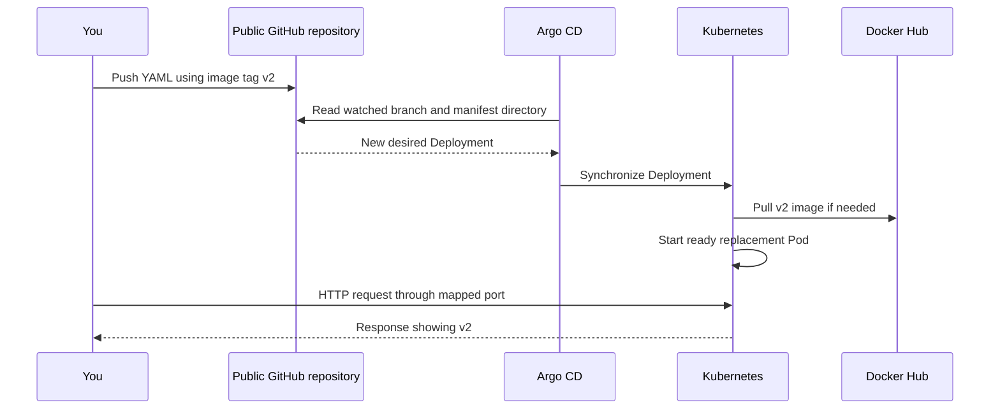

# Part 3: let Git change the running application

[Start page](../README.md) · [Previous: Part 2](../p2/README.md) · [Next: evaluation](../docs/05-evaluation.md)

Goal: Docker runs a K3d cluster in the Linux lab VM. Argo CD runs in `argocd`; the example app runs in `dev`. You push an image-tag change to GitHub and watch the app change from v1 to v2 without applying its Deployment by hand.



Plain-text reading: you push instructions to Git; Argo CD applies those instructions; Kubernetes obtains the image from Docker Hub and replaces the Pod; an HTTP request proves the result.

## 1. Keep the two repositories straight

You may use one repository for both the assignment and deployment, or a separate public deployment repository. This guide uses a separate one so the distinction is clear:

```text
42IoT/                              YOUR_LOGIN-iot-app/ (public on GitHub)
└─ p3/                              └─ manifests/
   ├─ scripts/                         ├─ deployment.yaml
   │  ├─ install-dependencies.sh        └─ service.yaml
   │  └─ bootstrap.sh
   └─ confs/
      ├─ argocd-install.yaml
      └─ application.yaml  ─────────────> watches manifests/ on branch main
```

The deployment repository name must contain a group member's **school login**. Create it as **public**, with a `main` branch. Use the correct GitHub owner separately from the login in its repository name. Do not assume the existing `42IoT` name satisfies that rule.

If you use the assignment repository instead, keep the manifests under `p3/confs/workload/` and set the Argo Application's `source.path` to that exact path. Keep the Argo installation and Application definition outside the watched workload directory. Argo should not accidentally deploy every YAML file in your repository.

## 2. Write and test your dependency installer

The subject explicitly asks for an installation script. Installing tools once by hand is not that deliverable. Create **`p3/scripts/install-dependencies.sh`** from the example below, review it, and test it on a clean **Debian lab VM**. It assumes a fresh Docker installation; resolve conflicting pre-existing Docker/Podman packages using the official instructions rather than blindly uninstalling software.

First create its directories, **LAB**, from the assignment repository root:

```bash
mkdir -p p3/scripts p3/confs
```

Pick real compatible versions from the [K3d releases](https://github.com/k3d-io/k3d/releases) and [kubectl installation guide](https://kubernetes.io/docs/tasks/tools/install-kubectl-linux/). Replace placeholders in **LAB**:

```bash
export IOT_K3D_VERSION='YOUR_VERIFIED_K3D_RELEASE'
export IOT_KUBECTL_VERSION='YOUR_VERIFIED_KUBECTL_RELEASE'
export IOT_K3D_IMAGE='YOUR_VERIFIED_RANCHER_K3S_IMAGE_AND_TAG'
export IOT_ARGOCD_VERSION='YOUR_VERIFIED_ARGOCD_RELEASE'
```

Release variables include the leading `v`. The node image is a full reference such as `rancher/k3s:vX.Y.Z-k3sN`, with a **real published tag**. K3s image tags use `-k3sN` where binary release strings use `+k3sN`. Choose a K3s image supported by your K3d release and a kubectl client within one minor version of the Kubernetes server. The latest kubectl is not automatically compatible with an older K3d default image.

File content for **`p3/scripts/install-dependencies.sh`**:

```bash
#!/usr/bin/env bash
set -euo pipefail
: "${IOT_K3D_VERSION:?Set a verified K3d release}"
: "${IOT_KUBECTL_VERSION:?Set a compatible kubectl release}"
if [[ $EUID -ne 0 ]]; then
  echo 'Run this installer with sudo and the two version variables' >&2
  exit 1
fi
. /etc/os-release
[[ "$ID" == debian ]] || { echo 'This example targets Debian' >&2; exit 1; }
arch=$(dpkg --print-architecture)
case "$arch" in amd64|arm64) ;; *) echo 'Review binary architecture support'; exit 1 ;; esac

apt-get update
apt-get install -y ca-certificates curl git
install -d -m 0755 /etc/apt/keyrings
curl -fsSL https://download.docker.com/linux/debian/gpg \
  -o /etc/apt/keyrings/docker.asc
chmod a+r /etc/apt/keyrings/docker.asc
cat > /etc/apt/sources.list.d/docker.sources <<EOF
Types: deb
URIs: https://download.docker.com/linux/debian
Suites: ${VERSION_CODENAME}
Components: stable
Architectures: ${arch}
Signed-By: /etc/apt/keyrings/docker.asc
EOF
apt-get update
apt-get install -y docker-ce docker-ce-cli containerd.io \
  docker-buildx-plugin docker-compose-plugin
systemctl enable --now docker

work_dir=$(mktemp -d)
trap 'rm -rf -- "$work_dir"' EXIT
curl -fsSL "https://dl.k8s.io/release/${IOT_KUBECTL_VERSION}/bin/linux/${arch}/kubectl" \
  -o "$work_dir/kubectl"
curl -fsSL "https://dl.k8s.io/release/${IOT_KUBECTL_VERSION}/bin/linux/${arch}/kubectl.sha256" \
  -o "$work_dir/kubectl.sha256"
printf '%s  %s\n' "$(cat "$work_dir/kubectl.sha256")" "$work_dir/kubectl" | sha256sum -c -
install -m 0755 "$work_dir/kubectl" /usr/local/bin/kubectl

curl -fsSL "https://raw.githubusercontent.com/k3d-io/k3d/${IOT_K3D_VERSION}/install.sh" \
  -o "$work_dir/install-k3d.sh"
TAG="$IOT_K3D_VERSION" bash "$work_dir/install-k3d.sh"
docker --version
kubectl version --client
k3d version
```

This implements the [Docker Debian repository method](https://docs.docker.com/engine/install/debian/) and verifies kubectl's downloaded checksum. Review the K3d install script from the selected release before running it. Docker package versions track the stable apt repository in this starting example; record installed versions and pin them as well if your rebuild must be byte-for-byte reproducible. A pinned K3d release does not pin the separately selected K3s node image.

**LAB**, repository root:

```bash
mkdir -p p3/scripts p3/confs
chmod +x p3/scripts/install-dependencies.sh
sudo env IOT_K3D_VERSION="$IOT_K3D_VERSION" \
  IOT_KUBECTL_VERSION="$IOT_KUBECTL_VERSION" \
  bash p3/scripts/install-dependencies.sh
```

Configure Docker access as described in [workspace setup](../docs/03-workspace.md#docker-for-part-3), then log back in and check `docker info`. All later commands run as your normal lab user, **without sudo**, so K3d writes kubeconfig for that user.

## 3. Create a K3d cluster with an application port

**LAB**:

```bash
docker info
k3d cluster create iot --servers 1 --agents 0 \
  --image "$IOT_K3D_IMAGE" \
  --api-port 127.0.0.1:6550 \
  --port '127.0.0.1:8888:30888@server:0' \
  --wait
kubectl config use-context k3d-iot
kubectl config current-context
kubectl get nodes -o wide
kubectl version
```

The [K3d create command](https://k3d.io/stable/usage/commands/k3d_cluster_create/) creates containerized nodes and updates kubeconfig. Here there is one server node, which can also run workloads. `@server:0` targets that first server container. The API is reachable on lab loopback port 6550; the app will be on lab loopback 8888.

We map a **NodePort**, not an Ingress, for this part:

```text
LAB 127.0.0.1:8888
    → Docker published port on K3d server container:30888
    → Kubernetes NodePort Service playground:8888
    → application's Pod:8888
```

Publishing a Docker port does not create a Kubernetes Service. Setting `containerPort` does not publish a Docker port. You need both ends. See [K3d's service exposure guide](https://k3d.io/stable/usage/exposing_services/).

Keep the command in a future `p3/scripts/bootstrap.sh` along with the namespace and Argo bootstrap steps below. Make your script detect an existing `iot` cluster and either reuse it deliberately or stop with an explanation; do not quietly create a second cluster or delete one.

## 4. Install Argo CD and create the namespaces

**LAB**, repository root, after choosing an actual supported Argo CD release:

```bash
kubectl create namespace argocd --dry-run=client -o yaml | kubectl apply -f -
kubectl create namespace dev --dry-run=client -o yaml | kubectl apply -f -
curl -fsSL "https://raw.githubusercontent.com/argoproj/argo-cd/${IOT_ARGOCD_VERSION}/manifests/install.yaml" \
  -o p3/confs/argocd-install.yaml
sha256sum p3/confs/argocd-install.yaml
kubectl apply --server-side -n argocd -f p3/confs/argocd-install.yaml
kubectl wait --for=condition=Established crd/applications.argoproj.io --timeout=180s
kubectl -n argocd rollout status deployment/argocd-server --timeout=300s
kubectl -n argocd rollout status deployment/argocd-repo-server --timeout=300s
kubectl -n argocd rollout status statefulset/argocd-application-controller --timeout=300s
kubectl -n argocd get pods
kubectl get namespaces
```

The downloaded manifest is upstream configuration. Keep its exact release and checksum with your submission; review it before applying. Server-side apply avoids large client-side annotation problems with CRDs. If a pre-existing installation reports field-ownership conflicts, investigate them before using any force flag. This guide assumes a fresh cluster. [Argo CD's getting-started guide](https://argo-cd.readthedocs.io/en/stable/getting_started/) describes installation and access.

Kubernetes also creates system namespaces. The subject's two namespaces are the additional functional ones, not a demand that only two namespaces exist in total.

## 5. Open the Argo CD UI

**LAB, terminal A**; leave it running:

```bash
kubectl -n argocd port-forward service/argocd-server 8080:443
```

Open **`https://127.0.0.1:8080` inside the lab VM**, or use the Windows SSH tunnel from [workspace setup](../docs/03-workspace.md#network-addresses-are-relative-to-a-machine). Use HTTPS here. The lab's default certificate may trigger a browser warning; verify it is your local endpoint.

**LAB, terminal B**; show the initial password locally:

```bash
kubectl -n argocd get secret argocd-initial-admin-secret \
  -o jsonpath='{.data.password}' | base64 --decode
printf '\n'
```

Username is `admin`. Do not commit the password or screenshots containing it. Change the password through Argo CD and handle the initial-password Secret according to its getting-started instructions. The Argo CLI is optional for this guide; UI and kubectl are enough for the demonstration.

## 6. Put the app manifests in your public deployment repository

Clone your public `YOUR_LOGIN-iot-app` repository in another directory, next to `42IoT`. In **that checkout**, make `manifests/`. Create **`manifests/deployment.yaml`**:

```yaml
apiVersion: apps/v1
kind: Deployment
metadata:
  name: playground
  namespace: dev
spec:
  replicas: 1
  selector:
    matchLabels:
      app: playground
  template:
    metadata:
      labels:
        app: playground
    spec:
      containers:
        - name: playground
          image: wil42/playground:v1
          ports:
            - name: http
              containerPort: 8888
          readinessProbe:
            httpGet:
              path: /
              port: http
            initialDelaySeconds: 2
            periodSeconds: 3
```

Create **`manifests/service.yaml`** in that same repository:

```yaml
apiVersion: v1
kind: Service
metadata:
  name: playground
  namespace: dev
spec:
  type: NodePort
  selector:
    app: playground
  ports:
    - name: http
      port: 8888
      targetPort: http
      nodePort: 30888
```

The subject supplies this image and port. Verify the [Docker Hub tags](https://hub.docker.com/r/wil42/playground/tags) and your architecture before depending on them; they were not pulled or executed during this documentation task. If the supplied image is unavailable or incompatible, use the own-app alternative below. A Docker registry authentication/rate-limit failure is different from a Kubernetes YAML error.

**LAB, deployment repository checkout**:

```bash
git add manifests/deployment.yaml manifests/service.yaml
git diff --cached
git commit -m "Deploy playground v1"
git push -u origin main
```

Use your repository's actual branch if it differs. Open GitHub and verify that both files are visible publicly. **Do not `kubectl apply` these workload files**: Argo CD is about to fetch and deploy them from Git.

## 7. Tell Argo CD which Git directory to watch

Back in the assignment checkout, create **`p3/confs/application.yaml`**. Replace the owner and repository name; change `targetRevision` if your branch is not `main`.

```yaml
apiVersion: argoproj.io/v1alpha1
kind: Application
metadata:
  name: playground
  namespace: argocd
spec:
  project: default
  source:
    repoURL: https://github.com/YOUR_GITHUB_OWNER/YOUR_LOGIN-iot-app.git
    targetRevision: main
    path: manifests
  destination:
    server: https://kubernetes.default.svc
    namespace: dev
  syncPolicy:
    automated:
      prune: true
      selfHeal: true
    syncOptions:
      - CreateNamespace=true
```

`source` tells Argo where the desired state lives. `destination` says to deploy it into `dev` on the same cluster. The Application object itself belongs in `argocd`.

`automated` enables synchronization. `prune` allows deleting managed resources removed from Git. `selfHeal` allows Argo to undo manual changes in the cluster. Keep this watched directory limited to the exercise app so those actions have clear scope. See [the Application reference](https://argo-cd.readthedocs.io/en/stable/user-guide/application-specification/) and [automatic sync policy](https://argo-cd.readthedocs.io/en/stable/user-guide/auto_sync/).

**LAB, assignment repository root**:

```bash
kubectl apply -f p3/confs/application.yaml
kubectl -n argocd get application playground -w
```

Wait for **Synced** and **Healthy**, then press Ctrl+C to stop watching. This stops your display, not Argo CD. It may take a few minutes for detection, image pulls, and rollout. A GitHub webhook can accelerate notification but is not needed for the basic automatic polling workflow.

```bash
kubectl -n dev get deployments,pods,services
kubectl -n dev rollout status deployment/playground --timeout=180s
curl --fail --show-error http://127.0.0.1:8888
```

The subject's example response includes a message identifying `v1`. Check the real response, not just an HTTP 200 status.

## 8. The demonstration that matters: v1 → v2 through Git

In the **deployment repository**, edit exactly the image line in `manifests/deployment.yaml`:

```text
Before: image: wil42/playground:v1
After:  image: wil42/playground:v2
```

Then:

```bash
git diff
git add manifests/deployment.yaml
git commit -m "Deploy playground v2"
git push origin main
git rev-parse HEAD
```

Record that commit SHA. Do not use `kubectl set image`, edit the running Deployment, or manually apply the workload YAML to make the demonstration appear to work.

In another **LAB** terminal, inspect Argo CD:

```bash
kubectl -n argocd get application playground -w
```

After synchronization, Ctrl+C and inspect both desired and running state:

```bash
kubectl -n argocd get application playground \
  -o jsonpath='{.status.sync.revision}{"\n"}{.status.sync.status}{"\n"}{.status.health.status}{"\n"}'
kubectl -n dev get deployment playground \
  -o jsonpath='{.spec.template.spec.containers[0].image}{"\n"}'
kubectl -n dev rollout status deployment/playground --timeout=180s
kubectl -n dev get pods -l app=playground \
  -o custom-columns='NAME:.metadata.name,IMAGE:.spec.containers[0].image,READY:.status.containerStatuses[0].ready'
curl --fail --show-error http://127.0.0.1:8888
```

Check **all four facts**: Argo's synced revision is your pushed commit; the Deployment names `v2`; the new Pod is ready; HTTP reports `v2`. `rollout status` by itself can succeed on the old rollout if Argo has not updated the Deployment yet.

To return to v1, make another Git commit restoring the v1 image tag and push it. Let the same reconciliation happen. That is a repeatable rollback for this exercise.

## 9. If you choose to write your own app

Use a server that listens on `0.0.0.0` inside its container, not only `127.0.0.1`. Keep it as small as a page or JSON response showing `v1` or `v2`. You can use Nginx and different `index.html` files; a compiled app is not necessary.

Build and publish **two distinct images** to a public Docker Hub repository. Example commands from your own application's build directory, replacing the owner and repo:

```bash
docker build -t YOUR_DOCKERHUB_USER/YOUR_APP:v1 .
docker login
docker push YOUR_DOCKERHUB_USER/YOUR_APP:v1
```

Change the served content to identify v2, build with `:v2`, and push that tag too. Match `containerPort`, the readiness probe, and Service target to the actual listener. The LAB's external 8888 and NodePort 30888 can remain the same even if your container listens on 80.

Prove public pulls work without relying on your local image cache. Argo CD still reads the image-tag selection from Git; it does not build either image. Keep Docker Hub credentials out of YAML and Git.

## 10. Finish the automation and prove a clean rebuild

Move the successful bootstrap steps into **`p3/scripts/bootstrap.sh`**: validate inputs and Docker access, create/reuse the intended K3d cluster, select the context, create namespaces, install the pinned Argo configuration, wait for readiness, and apply the Application definition. Keep browser login and foreground port-forward instructions separate.

Run the dependency installer and bootstrap on a clean VM. A script that only works because yesterday's packages, kubeconfig, or namespaces remain is not a reliable installation script. Document required inputs and re-run behavior. Do not treat the illustrative snippets in this README as proof of that clean-machine test.

For a pause, `k3d cluster stop iot` and later `k3d cluster start iot` retain the cluster. `k3d cluster delete iot` deliberately deletes the lab cluster and its state; use it only when you intend a rebuild. The committed manifests and image registry remain available for reconstruction. Bonus persistent data needs additional care.

Part 3 is complete when your scripts recreate the environment, both namespaces exist, Argo reports Healthy/Synced, and a public GitHub commit changes the observed app version during your demonstration.
